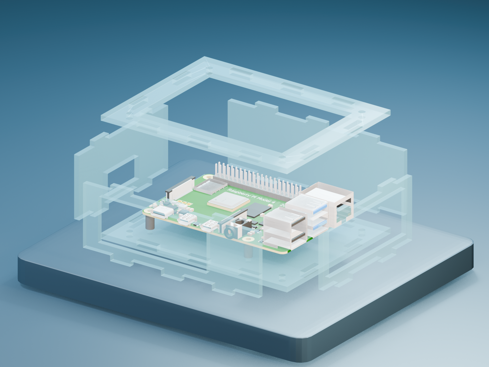

# Raspberry Pi 4 acrylic case — 3D showcase

This is an exploded view of the six-panel prototype case. The panel geometry follows the [case generator](../generate.py) and its [DXF cut sheet](../output/prototype-cut-sheet.dxf). The acrylic is shown as transparent blue in Blender and GLB. The Raspberry Pi 4 board is a detailed visual model positioned above the four mounting standoffs.

## Open the model

- [STL](raspberry-pi-4-acrylic-showcase.stl): open this file on GitHub to rotate and zoom the whole assembly in GitHub's 3D viewer. STL does not preserve colour or transparency.
- [GLB](raspberry-pi-4-acrylic-showcase.glb): colour 3D model with transparent acrylic for compatible viewers.
- [Blender project](raspberry-pi-4-acrylic-showcase.blend): editable scene with lighting, camera, materials, and the model.
- [PNG render](raspberry-pi-4-blender-render.png): static preview.

The detailed board model comes from [Raspberry-Pi-Web-Showcase](https://github.com/butaraul/Raspberry-Pi-Web-Showcase) by Raul, distributed under the [MIT license](BOARD-MODEL-LICENSE.txt). It is an independent visual reconstruction, not official Raspberry Pi CAD. The case remains a fit-check prototype; verify physical board, connector, cable, acrylic, and laser kerf clearances before cutting.
