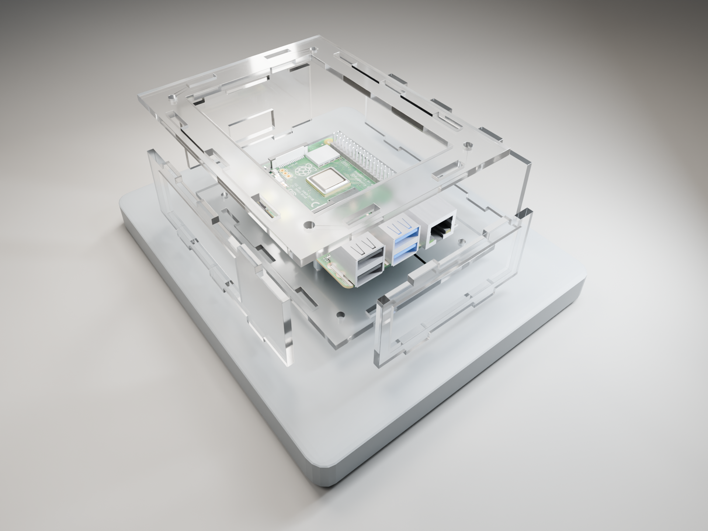
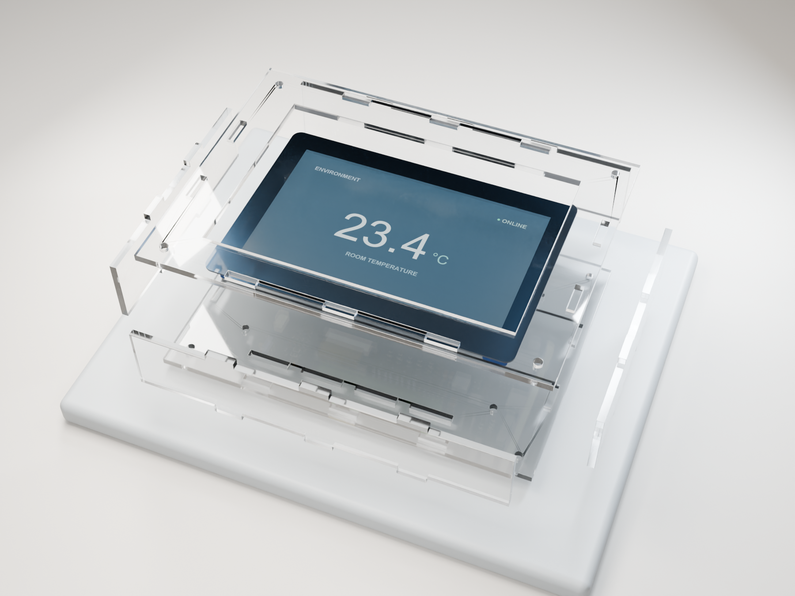

# Інструкція для майстерні: різання деталей з акрилу

Виріжте за файлами DXF **по одному комплекту деталей** для Raspberry Pi 4 Model B, Waveshare 5″ і Waveshare 7B. Матеріал — литий акрил номінальною товщиною **3 мм**. Передайте вирізані деталі окремими комплектами для подальшого складання. Усі розміри в DXF наведено в міліметрах.

## 3D-вигляд корпусів

| Raspberry Pi 4 Model B | Waveshare 5″ | Waveshare 7B |
| :---: | :---: | :---: |
|  |  |  |
| [Обертати 3D-модель](../Raspberry/V4/visualization/raspberry-pi-4-acrylic-showcase.stl) | [Обертати 3D-модель](../visualization/waveshare-5b/waveshare-5b-acrylic-showcase.stl) | [Обертати 3D-модель](../visualization/waveshare-7b/waveshare-7b-acrylic-showcase.stl) |

| Waveshare 5B з опорами, вигляд ззаду | Waveshare 7B з опорами, вигляд ззаду |
| :---: | :---: |
|  |  |

На зображеннях показано розташування деталей у корпусах. Для різання використовуйте DXF із відповідного розділу нижче або спільний DXF наприкінці інструкції.

## 1. Raspberry Pi 4 Model B

Комплект для корпусу 110 × 86 × 40 мм містить нижню й верхню панелі та чотири бічні стінки для живлення/HDMI/AV, USB/Ethernet, microSD і GPIO. У верхній панелі є отвір для доступу до роз’ємів. У бічних стінках передбачені отвори для портів.

[DXF — усі шість деталей](../Raspberry/V4/output/prototype-cut-sheet.dxf)

## 2. Екран Waveshare 5″

Комплект містить лицьову, задню, верхню й нижню панелі, ліву й праву стінки та дві опори. Габарит лицьової панелі — 160 × 115 мм. Отвір під металеву частину екрана — **121,7 × 80,6 мм**. Під час складання кольоровий край екрана спирається на лицьову панель для кріплення двосторонньою стрічкою.

[DXF — усі вісім деталей](../output/finger-joint/waveshare-5b/prototype-cut-sheet.dxf)

## 3. Екран Waveshare 7B

Комплект містить шість панелей і дві опори. Габарит лицьової панелі — 224 × 140 мм. Отвір під металеву частину екрана — **168,3 × 102,8 мм**. Під час складання кольоровий край екрана спирається на лицьову панель для кріплення двосторонньою стрічкою.

[DXF — усі вісім деталей](../output/finger-joint/waveshare-7b/prototype-cut-sheet.dxf)

У задній панелі кожного комплекту Waveshare є чотири наскрізні пази 3,10 × 12,10 мм, по два на кожну опору.

## Усі деталі в одному файлі

[DXF — усі 22 деталі для трьох корпусів](../output/finger-joint/workshop-all-cases.dxf)

