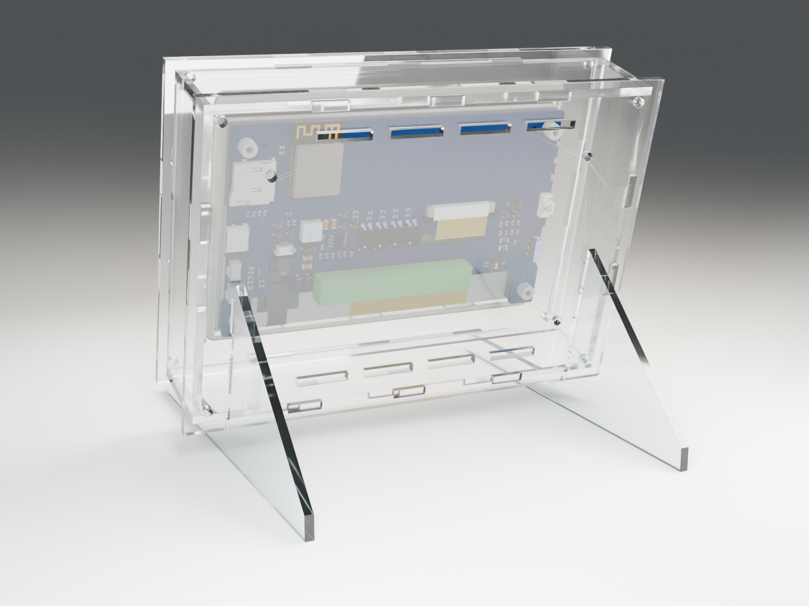
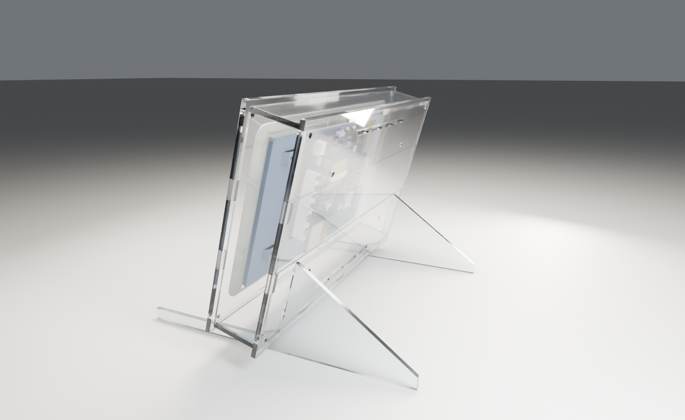

# Інструкція для майстерні: акрилові корпуси

Потрібно виготовити **три окремі пробні корпуси** з литого акрилу номінальною товщиною **3 мм**: для Raspberry Pi 4 Model B, екрана Waveshare 5″ та екрана Waveshare 7B. Корпус Raspberry Pi складається із шести деталей. Кожен корпус Waveshare має шість панелей і дві трикутні опори. Усі розміри у файлах — у міліметрах.

## 3D-вигляд корпусів

| Raspberry Pi 4 Model B | Waveshare 5″ | Waveshare 7B |
| :---: | :---: | :---: |
|  |  |  |
| [Обертати 3D-модель](../Raspberry/V4/visualization/raspberry-pi-4-acrylic-showcase.stl) | [Обертати 3D-модель](../visualization/waveshare-5b/waveshare-5b-acrylic-showcase.stl) | [Обертати 3D-модель](../visualization/waveshare-7b/waveshare-7b-acrylic-showcase.stl) |

| Waveshare 5B з опорами, вигляд ззаду | Waveshare 7B з опорами, вигляд ззаду |
| :---: | :---: |
|  |  |

Для різання використовуйте DXF із відповідного розділу нижче.

## 1. Raspberry Pi 4 Model B

Корпус 110 × 86 × 40 мм. Потрібні нижня та верхня панелі, а також чотири бічні стінки: для живлення/HDMI/AV, USB/Ethernet, microSD і GPIO. У верхній панелі є отвір для доступу до роз’ємів. У бічних стінках передбачені отвори для портів.

[DXF — усі шість деталей](../Raspberry/V4/output/prototype-cut-sheet.dxf)

## 2. Екран Waveshare 5″

Потрібні лицьова, задня, верхня й нижня панелі, ліва й права стінки та дві опори. Габарит лицьової панелі — 160 × 115 мм; отвір під металеву частину екрана — **121,7 × 80,6 мм**. Кольоровий край екрана має залишатися на лицьовому акрилі для кріплення двосторонньою стрічкою.

[DXF — усі вісім деталей](../output/finger-joint/waveshare-5b/prototype-cut-sheet.dxf)

## 3. Екран Waveshare 7B

Потрібні шість панелей і дві опори. Габарит лицьової панелі — 224 × 140 мм; отвір під металеву частину екрана — **168,3 × 102,8 мм**. Кольоровий край залишається на акрилі для кріплення двосторонньою стрічкою.

[DXF — усі вісім деталей](../output/finger-joint/waveshare-7b/prototype-cut-sheet.dxf)

У задній панелі кожного корпусу Waveshare є чотири наскрізні пази 3,10 × 12,10 мм під два шипи кожної опори. Приміряйте опори насухо після пробного різу, потім закріпіть клеєм для акрилу.

## Усі деталі в одному файлі

[DXF — усі 22 деталі для трьох корпусів](../output/finger-joint/workshop-all-cases.dxf)

