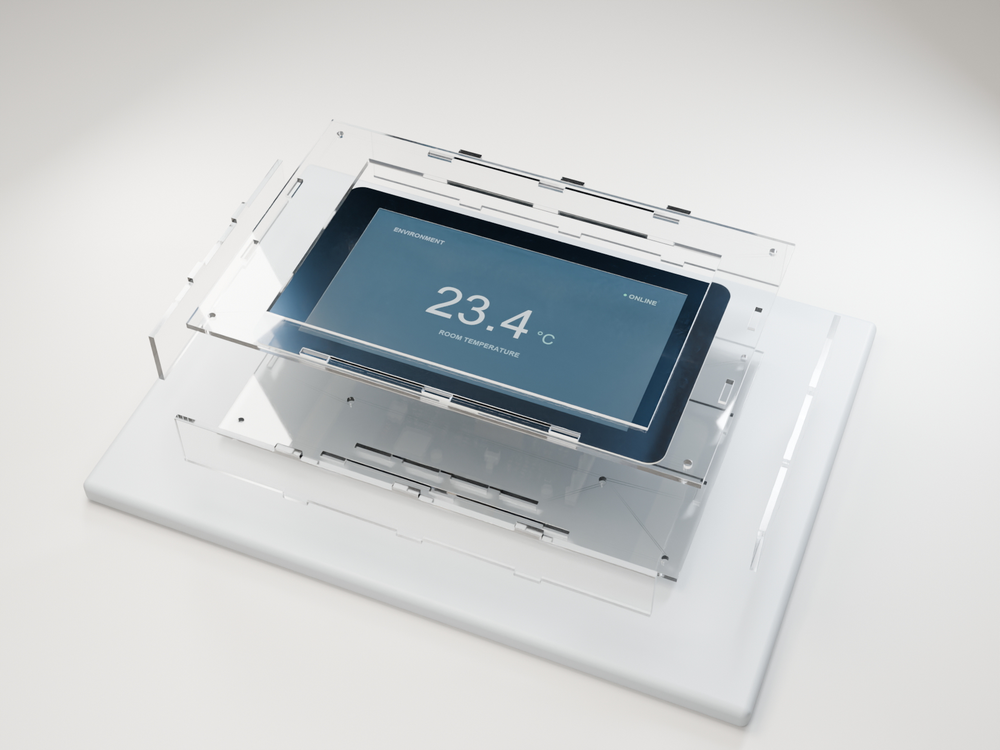

# Інструкція для майстерні: акрилові корпуси

Потрібно виготовити **три окремі пробні корпуси** з литого акрилу номінальною товщиною **3 мм**: для Raspberry Pi 4 Model B, екрана Waveshare 5″ та екрана Waveshare 7B. Корпус Raspberry Pi складається із шести деталей. Кожен корпус Waveshare має шість панелей і дві трикутні опори. Усі розміри у файлах — у міліметрах.

## 3D-вигляд корпусів

| Raspberry Pi 4 Model B | Waveshare 5″ | Waveshare 7B |
| :---: | :---: | :---: |
|  |  |  |
| [Обертати 3D-модель](../Raspberry/V4/visualization/raspberry-pi-4-acrylic-showcase.stl) | [Обертати 3D-модель](../visualization/waveshare-5b/waveshare-5b-acrylic-showcase.stl) | [Обертати 3D-модель](../visualization/waveshare-7b/waveshare-7b-acrylic-showcase.stl) |

Для різання використовуйте DXF із відповідного розділу нижче.

## 1. Raspberry Pi 4 Model B

Корпус 110 × 86 × 40 мм. Потрібні нижня та верхня панелі, а також чотири бічні стінки: для живлення/HDMI/AV, USB/Ethernet, microSD і GPIO. У верхній панелі є отвір для доступу до роз’ємів. У бічних стінках передбачені отвори для портів.

**Файли для різання й перевірки:**

- [DXF — усі шість деталей](https://github.com/shaposhnikoff/esp32-s3-5-7-box-cases/blob/main/Raspberry/V4/output/prototype-cut-sheet.dxf)
- [PDF — усі деталі на одному аркуші A4, масштаб 1:1](https://github.com/shaposhnikoff/esp32-s3-5-7-box-cases/blob/main/Raspberry/V4/output/a4-cut-layout.pdf)
- [PDF — шість окремих шаблонів A4, масштаб 1:1](https://github.com/shaposhnikoff/esp32-s3-5-7-box-cases/blob/main/Raspberry/V4/output/a4-fit-templates.pdf)
- [SVG — нижня панель](https://github.com/shaposhnikoff/esp32-s3-5-7-box-cases/blob/main/Raspberry/V4/output/bottom.svg)
- [SVG — верхня панель з отвором](https://github.com/shaposhnikoff/esp32-s3-5-7-box-cases/blob/main/Raspberry/V4/output/top-open-gpio.svg)
- [SVG — стінка живлення/HDMI/AV](https://github.com/shaposhnikoff/esp32-s3-5-7-box-cases/blob/main/Raspberry/V4/output/power-hdmi-av.svg)
- [SVG — стінка USB/Ethernet](https://github.com/shaposhnikoff/esp32-s3-5-7-box-cases/blob/main/Raspberry/V4/output/usb-ethernet.svg)
- [SVG — стінка microSD](https://github.com/shaposhnikoff/esp32-s3-5-7-box-cases/blob/main/Raspberry/V4/output/microsd-side.svg)
- [SVG — стінка GPIO](https://github.com/shaposhnikoff/esp32-s3-5-7-box-cases/blob/main/Raspberry/V4/output/gpio-side.svg)
- [DXF пробного з’єднання](https://github.com/shaposhnikoff/esp32-s3-5-7-box-cases/blob/main/Raspberry/V4/output/fit-coupon.dxf) · [PDF пробного з’єднання](https://github.com/shaposhnikoff/esp32-s3-5-7-box-cases/blob/main/Raspberry/V4/output/fit-coupon.pdf) · [SVG пазів](https://github.com/shaposhnikoff/esp32-s3-5-7-box-cases/blob/main/Raspberry/V4/output/fit-slots.svg) · [SVG зубця](https://github.com/shaposhnikoff/esp32-s3-5-7-box-cases/blob/main/Raspberry/V4/output/fit-tab.svg)

## 2. Екран Waveshare 5″

Потрібні лицьова, задня, верхня й нижня панелі, ліва й права стінки та дві опори. Габарит лицьової панелі — 160 × 115 мм; отвір під металеву частину екрана — **121,7 × 80,6 мм**. Кольоровий край екрана має залишатися на лицьовому акрилі для кріплення двосторонньою стрічкою.

- [DXF — усі вісім деталей](../output/finger-joint/waveshare-5b/prototype-cut-sheet.dxf)
- [PDF — лицьова панель 1:1](https://github.com/shaposhnikoff/esp32-s3-5-7-box-cases/blob/main/output/finger-joint/waveshare-5b/front-panel-1to1.pdf)
- [PDF — вісім шаблонів A4, масштаб 1:1](../output/finger-joint/waveshare-5b/a4-fit-templates.pdf)
- [SVG — лицьова панель](https://github.com/shaposhnikoff/esp32-s3-5-7-box-cases/blob/main/output/finger-joint/waveshare-5b/front.svg)
- [SVG — задня панель із пазами](../output/finger-joint/waveshare-5b/rear.svg)
- [SVG — ліва опора](../output/finger-joint/waveshare-5b/left-support.svg) · [SVG — права опора](../output/finger-joint/waveshare-5b/right-support.svg)
- [SVG — верхня панель](https://github.com/shaposhnikoff/esp32-s3-5-7-box-cases/blob/main/output/finger-joint/waveshare-5b/top.svg)
- [SVG — нижня панель](https://github.com/shaposhnikoff/esp32-s3-5-7-box-cases/blob/main/output/finger-joint/waveshare-5b/bottom.svg)
- [SVG — ліва стінка](https://github.com/shaposhnikoff/esp32-s3-5-7-box-cases/blob/main/output/finger-joint/waveshare-5b/left.svg)
- [SVG — права стінка](https://github.com/shaposhnikoff/esp32-s3-5-7-box-cases/blob/main/output/finger-joint/waveshare-5b/right.svg)

## 3. Екран Waveshare 7B

Потрібні шість панелей і дві опори. Габарит лицьової панелі — 224 × 140 мм; отвір під металеву частину екрана — **168,3 × 102,8 мм**. Кольоровий край залишається на акрилі для кріплення двосторонньою стрічкою.

- [DXF — усі вісім деталей](../output/finger-joint/waveshare-7b/prototype-cut-sheet.dxf)
- [PDF — лицьова панель 1:1](https://github.com/shaposhnikoff/esp32-s3-5-7-box-cases/blob/main/output/finger-joint/waveshare-7b/front-panel-1to1.pdf)
- [PDF — вісім шаблонів A4, масштаб 1:1](../output/finger-joint/waveshare-7b/a4-fit-templates.pdf)
- [SVG — лицьова панель](https://github.com/shaposhnikoff/esp32-s3-5-7-box-cases/blob/main/output/finger-joint/waveshare-7b/front.svg)
- [SVG — задня панель із пазами](../output/finger-joint/waveshare-7b/rear.svg)
- [SVG — ліва опора](../output/finger-joint/waveshare-7b/left-support.svg) · [SVG — права опора](../output/finger-joint/waveshare-7b/right-support.svg)
- [SVG — верхня панель](https://github.com/shaposhnikoff/esp32-s3-5-7-box-cases/blob/main/output/finger-joint/waveshare-7b/top.svg)
- [SVG — нижня панель](https://github.com/shaposhnikoff/esp32-s3-5-7-box-cases/blob/main/output/finger-joint/waveshare-7b/bottom.svg)
- [SVG — ліва стінка](https://github.com/shaposhnikoff/esp32-s3-5-7-box-cases/blob/main/output/finger-joint/waveshare-7b/left.svg)
- [SVG — права стінка](https://github.com/shaposhnikoff/esp32-s3-5-7-box-cases/blob/main/output/finger-joint/waveshare-7b/right.svg)

У задній панелі кожного корпусу Waveshare є чотири наскрізні пази 3,10 × 12,10 мм під два шипи кожної опори. Приміряйте опори насухо після пробного різу, потім закріпіть клеєм для акрилу.

[Спільний DXF для Waveshare 7B і 5B — 16 деталей](../output/finger-joint/waveshare-7b-5b-cut-sheet.dxf)

