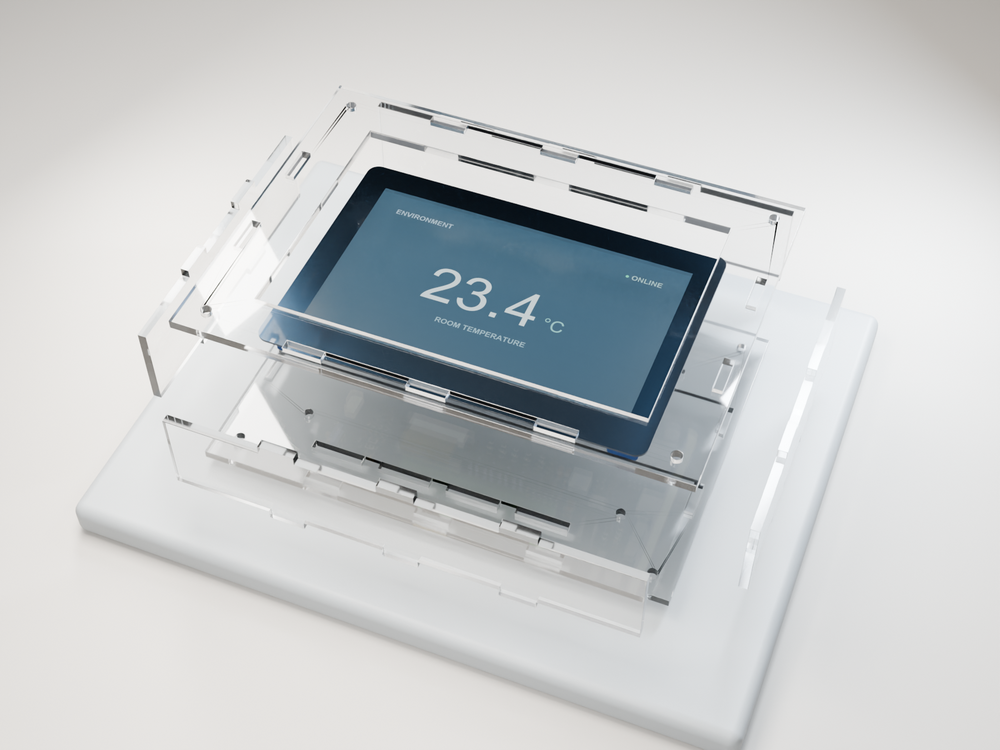
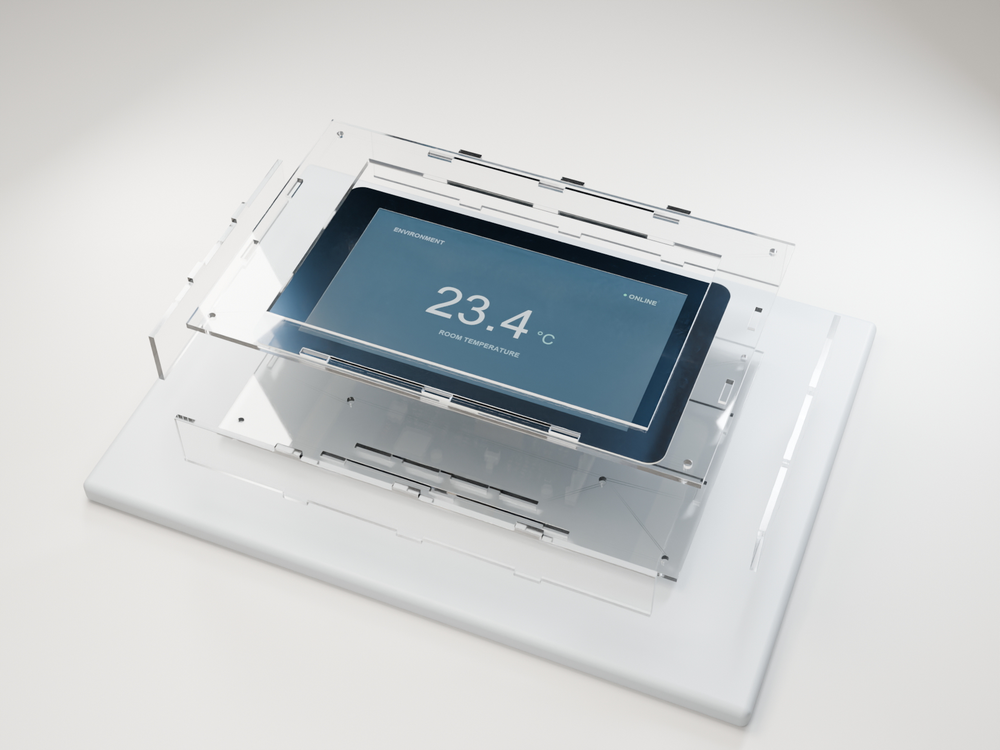

# Waveshare acrylic case previews

Each Blender project shows the screen module with all six 3 mm acrylic panels in an exploded view. Drag the STL on GitHub to rotate it, or scroll to zoom. The STL includes the six panels and the main screen components. Open the GLB in a compatible viewer for the detailed, full-colour assembly with transparent acrylic.

The photoreal projects use Cycles to show the acrylic's refraction and cut edges on a light studio background. The lit displays show a demo reading. Each project includes the display texture.

## Waveshare 5-inch

[Rotate on GitHub](waveshare-5b/waveshare-5b-acrylic-showcase.stl) · [Photoreal Blender project](waveshare-5b/waveshare-5b-photoreal.blend) · [Colour GLB](waveshare-5b/waveshare-5b-acrylic-showcase.glb) · [DXF cut sheet](../output/finger-joint/waveshare-5b/prototype-cut-sheet.dxf)

Original studio version · [Blender project](waveshare-5b/waveshare-5b-acrylic-showcase.blend) · [PNG](waveshare-5b/waveshare-5b-acrylic-render.png)

The display geometry comes from the supplied Waveshare `ESP32-S3-Touch-LCD-5_asm.stp`. The physical fit of the enclosure with the 5B variant remains unverified. [Waveshare 5-inch documentation](https://docs.waveshare.com/ESP32-S3-Touch-LCD-5)

## Waveshare 7B

[Rotate on GitHub](waveshare-7b/waveshare-7b-acrylic-showcase.stl) · [Photoreal Blender project](waveshare-7b/waveshare-7b-photoreal.blend) · [Colour GLB](waveshare-7b/waveshare-7b-acrylic-showcase.glb) · [DXF cut sheet](../output/finger-joint/waveshare-7b/prototype-cut-sheet.dxf)

Original studio version · [Blender project](waveshare-7b/waveshare-7b-acrylic-showcase.blend) · [PNG](waveshare-7b/waveshare-7b-acrylic-render.png)

The display geometry comes from the supplied Waveshare `ESP32-S3-Touch-LCD-7B-20251025.stp`. [Waveshare 7B documentation](https://docs.waveshare.com/ESP32-S3-Touch-LCD-7B)
